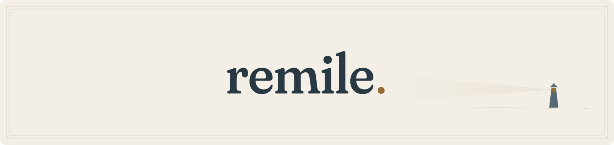

<picture>
  <source media="(prefers-color-scheme: dark)" srcset="others/banners/remile_banner_dark.svg">
  
</picture>

# remile.

A local workspace for reading and writing PDF, Markdown and LaTeX documents.

[Features](docs/features.md) · [CLI](docs/cli.md) · [Brand](docs/brand.md)

Open a document or a LaTeX project folder. Edit, preview, search and export in one window. Combine PDF or Markdown files, compress PDFs and convert documents to PDF. Local agents can inspect and edit sources through the CLI.

## Development

The Swift package builds `Remile` for macOS 14 and later. `tools/prepare_app.sh` packages `remile.app`; set `REMILE_BUILD_DIRECTORY` to an external build directory. Focused checks reside in `Tests` and `tools/check_*.sh`.

Keep implementation guidance in `agent/` and generated builds, fixtures and validation under `Agents/Repository/remile`.
