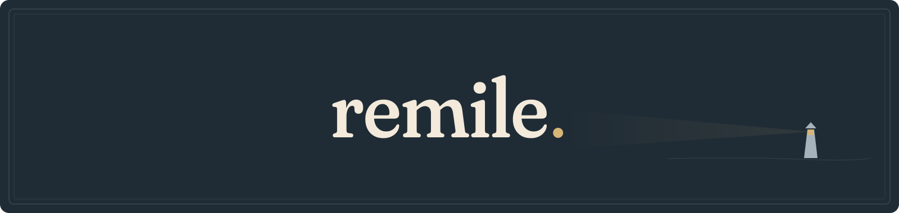

# Get started

Open a document and begin. Reading, writing and local search need no account.

## Install

Download the [Apple Silicon DMG](https://github.com/PentagonToy/remile/releases/download/v0.2.0/remile-0.2.0-arm64.dmg), open it and drag **remile.app** into **Applications**. You need an Apple Silicon Mac with macOS 14 or later.

The app is Developer ID signed and Apple-notarised. See [installation](distribution.md) for Homebrew and updates.

## Choose your first task

| I want to… | Start here |
| --- | --- |
| Read or annotate a paper | Open a PDF from Home. |
| Find a passage across PDFs | Open Search, add a folder to Library, then search. |
| Keep papers and citations together | Open Reference and drop in PDFs or BibTeX. |
| Write a short letter | Open Writer. Save as DOCX or export a PDF. |
| Write Markdown | Open a file or choose Markdown. Use Edit, Read or Split. |
| Work on a LaTeX project | Choose LaTeX and open its folder or source ZIP. A local TeX installation is needed to compile. |

## Make it yours

Settings controls appearance, reading and editing. In Storage, save a preset to bring supported preferences to another Mac. Your account connections and library paths stay local.

To share a Reference library through Dropbox or iCloud Drive, use Move storage to put it in a synced folder. On another Mac, wait for the folder to download, then use **Storage → Change → Open storage**. Restart remile to apply the change. Reference opens read only. See [storage and other Macs](reference.md#storage-and-other-macs) before enabling editing.

## Connect when you need to

Use Apple Intelligence on a supported Mac or connect ChatGPT in Settings → AI. Overleaf connects separately. Review suggested changes before applying them. Your ChatGPT plan and credit settings apply.

[Explore the workspace](features.md) · [Reference](reference.md) · [Writer](writer.md) · [Your files and privacy](privacy.md)

  
  

