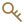

# Reference

Give the papers you return to a place of their own.

## Start a library

Open Reference from Home. Use Add or drop PDF and BibTeX files into Harbour. Imports copy PDFs into managed storage and leave the originals alone.

Create libraries and collections from the sidebar context menu. Drop a PDF onto a record when you want to attach it to that reference.

Right-click a library or collection and choose **Rename…** to change its name. Return or a click elsewhere saves a valid name. An empty name cancels when you leave the field, and Escape cancels the edit. Renaming keeps its references and collections together and supports Undo.

## Find and organise

Search by the details you remember. Click a column heading to sort, then click again to reverse the order. Drag a heading's edge to adjust its width.

PDFs are saved locally first. While online, remile uses a detected DOI or arXiv ID to fill missing details without AI. The airplane button pauses these lookups.

Double-click a metadata value or citation key to edit it. Click **Type** to choose a reference type. **Read metadata** reviews details extracted from the PDF. **Look up metadata** fills missing fields and available abstracts online by DOI, arXiv ID or an exact title match. Existing values stay unchanged, and no PDF is uploaded. Available abstracts appear below the dates in a collapsed Abstract section. [Metadata lookup details →](details/reference.md#metadata-lookup)

Web pages use a globe, newspaper articles use a newspaper, conference papers use a podium, and reports use a document icon. Imported website, news and report types are recognised alongside standard BibTeX types such as `online` and `techreport`. A URL alone does not change a paper's type.

In **Edit reference**, the **BibTeX** tab shows the current entry. Changes carry between **Details** and **BibTeX**.

Right-click a reference and choose **Lock citation key** to keep its key during regeneration. **Unlock citation key** allows regeneration again. Both actions work on a mixed selection of locked and unlocked references. You can still edit a locked key manually.

Edited books can list editors instead of authors. **Author / Editor** shows their names with `(ed.)` or `(eds.)`. New citation keys use the first editor's surname when no author is recorded. [Names and keys →](details/reference.md#columns-and-keys)

Missing a PDF? Right-click the reference and choose **Find a paper…**. remile checks local files and public sources. For subscription-only papers, download the PDF in your browser and add the local file. remile does not manage publisher sign-ins. [PDF lookup details →](details/reference.md#pdf-access)

## Cite while writing

Use the book button and **Use for citations** to check one or more libraries for the current document. Then choose a reference and its bibliography destination. In LaTeX and Overleaf, type `\cite{` to search keys, titles, authors and stored abstracts. Arrow keys move through the list. Return or Tab inserts a key, and Escape closes the list.

The preceding sentence helps put related sources first. This works offline without AI calls. An inserted library reference is added to the selected project bibliography. Existing entries are kept, and a conflicting key asks for attention.

## Read citation hints

Labels describe topic overlap with the available title and abstract. They do not rate paper quality or confirm that a source supports your claim.

| Label | Meaning | What to do |
| --- | --- | --- |
| **Topic match** | Several useful terms overlap with your sentence. | Read the relevant passage before citing. |
| **Limited overlap** | Some terms match, but the overlap is small. | Check the abstract or consider another source. |
| **No clear match** | No recognised terms overlap with the available text. | Check the paper. Different wording may still be relevant. |

When there is too little useful sentence context, no label appears. Ordinary key and metadata search still works. A key you type explicitly remains available even when its topic overlap is low.

The selected candidate also shows what was compared:

| Source basis | Meaning |
| --- | --- |
| **Title only** | No stored abstract is available for comparison. |
| **Title and abstract** | Both the title and stored abstract are available. |

An excerpt, when shown, comes from the stored abstract. It is not an AI summary or a verified quotation from an attached PDF. Use **Look up metadata** to try filling a missing abstract while online.

Background, fact, method and comparison hints describe possible uses of your sentence. They can overlap. [What each purpose asks you to check →](details/reference.md#citation-purpose-hints)

## Review before tidying

Clean up reviews metadata and duplicate candidates. Merge selected lets you choose the base record and keep distinct PDFs. Merged entries are removed without going to Trash.

Undo and Redo cover recent changes. Empty Trash permanently removes discarded records and unshared files after confirmation.

## Storage and other Macs

Keep the library in a local or synced folder. On another Mac, open the downloaded library read only first. [Set up shared storage →](storage.md#use-the-library-on-another-mac)

## Presets

Save supported preferences to a preset and load it on another Mac. Accounts and library paths stay local. [Save a preset →](storage.md#presets)

## Buttons at a glance

| Button | What it does |
| --- | --- |
|  **Clean up** | Review metadata and duplicate candidates. |
|  **Keys** | Regenerate citation keys after confirmation. |
|  **Library** | Organise references into libraries and collections. |
|  **PDF preview** | Read the selected attachment. |

[Shared buttons and status marks](buttons.md)

[Keys, metadata, attachments and saved passages](details/reference.md) · [AI review](assistant.md)

The preview starts with the selected title. Double-click it to edit. Abstract appears last and stays folded until opened.
