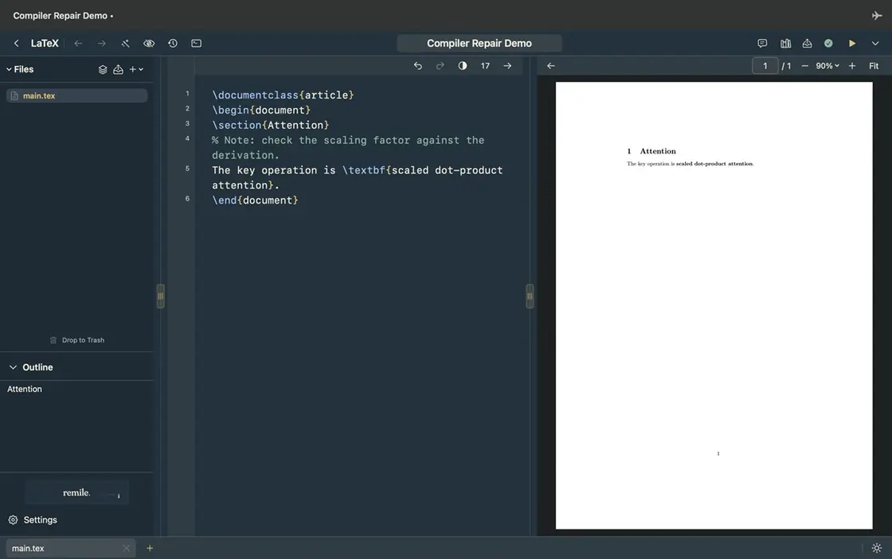
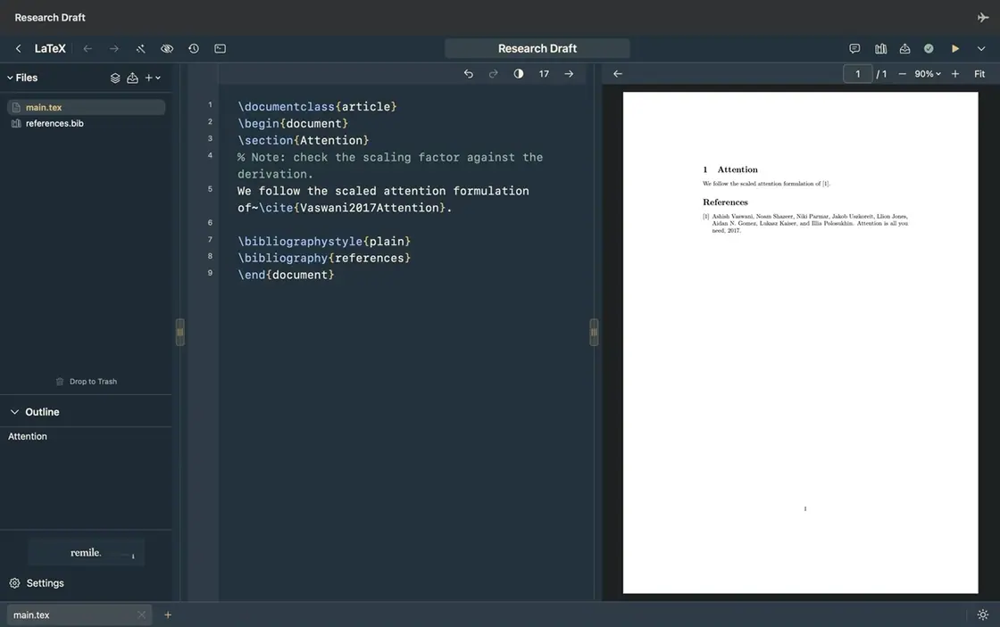

# LaTeX

Stay close to the source, with the finished page beside it.

## Open and compile

1. Choose **LaTeX** from Home to open an untitled draft. To open an existing project, drop its folder or source ZIP onto the LaTeX button.
2. Choose the main document if asked.
3. The first compile starts automatically with your local TeX installation. Choose Compile or press `⌘Return` after later edits.

Save chooses a folder for a new draft. An unchanged draft closes quietly. Edited drafts ask whether to save, discard or stay. Working copies remain in remile’s private draft folder until saved or discarded.

A source ZIP opens into a new project folder. The ZIP stays unchanged. Source remains editable if compilation fails.

## Find your way

Drop files or folders into **Files** or onto a project folder. Folder imports keep their nested structure. Compiling refreshes the list after changes made outside the app. To list or move files from a terminal, use the [CLI](../cli.md#open-editor).

Right-click a file, folder or collection and choose **Rename** to edit its row. For a file such as `figure.svg`, typing replaces the selected name `figure` and keeps `.svg`. Return or a click elsewhere saves a valid name. Escape cancels. EPS, SVG and raster graphics use the image icon. PDFs use the document icon.

Outline follows the project’s sections. Drag the divider to give either the source or PDF more room.

Use **Fit** to match the page height or choose **Fit width** in the zoom menu. Recompiling keeps your place in the preview. The same behaviour applies in Overleaf.

Opened files appear in the bottom tab bar. Select a tab to switch source, drag it to change its order, or use + to open another project file. Double-click a tab to edit its file name in **Files**. Closing a tab keeps your edits and the file in the project. At least one file stays open. Source tabs stay within their window.

Use **Control-Tab** and **Control-Shift-Tab** to move between source tabs. **Command-W** closes the current tab. When only one source tab remains, it closes the project through the usual save confirmation.

Source line numbers are on by default. Change **Settings → LaTeX → Line numbers** to hide them. The same setting applies to Overleaf sources.

Double-click in the PDF to return to the corresponding source. Word context refines the target when it matches clearly. Ambiguous text and figures keep the SyncTeX location. Selecting text alone does not move the source. Type `\cite{` to search your bibliography and Reference while writing. [Read the citation hints →](../reference.md#read-citation-hints)

Type `\input{`, `\include{` or `\includegraphics{` to see matching project files. Keep typing to narrow the list by filename or folder path. `\ref{…}` and `\eqref{…}` suggest labels from the project. Completing a supported `\begin{…}` inserts its matching end and places the cursor inside. These suggestions use local project data without a network request.

## Find and complete

Press `⌘F` to open Find below the source. `⌥⌘F` also opens the replacement row. `⌘G` moves to the next match and `⇧⌘G` to the previous one. Match case, whole words and regular expressions are available beside the query or in Search options when the pane is narrow. Escape closes Find. Replace and Replace All are undoable. In regular expressions, `$1`, `$2` and later groups refer to captured text.

Type a backslash and a letter for local command suggestions. `⌥Escape` opens completion after a bare backslash. Arrow keys choose an item, Return or Tab accepts it, and Escape dismisses the list. Common maths commands show a symbol or a short example beside the command.

Completion uses your project files for paths, labels, and commands defined with `\newcommand` or `\DeclareMathOperator`, including definitions in project style and class files. It also recognises selected commands from declared packages, such as `\ce{}` from `mhchem`. Accepting a command adds any required braces when there is no argument group already in place. The cursor moves inside the first argument. Project-defined environments receive a matching end.

Suggestions use a bounded, lazy project index off the UI thread. Very large files or projects may have definitions outside that index. The source remains editable and compilation still uses the complete project.

## Ask about your manuscript

Open the speech bubble for source-linked questions using your selected assistant. Choose **Review manuscript** above the message field to use your saved review criteria. This works without an Overleaf account.

## When a build needs attention

Open **Errors** beside **Compile**. Use the **Go to source** button on a diagnostic to open its file or line. **Errors**, **Warnings** and **Info** show separate counts. **Terminal** holds the full build output.

The preview shows any PDF the compiler produces. If a build produces no PDF, the previous preview stays visible when available. A green check means the PDF matches the current source.

With ChatGPT connected, use **Go to source** on the diagnostic, then choose **Suggest fix**. Review the proposed edit and choose **Apply and compile** to check the result.

Watch ChatGPT correct a misspelled command

Choose **Submission check** from the Compile menu to build a clean copy with your local TeX engine and the current project files. A supplied `.bbl` is checked without regenerating it. If the check fails, open the source error or build log.

Use **Settings → LaTeX → Check LaTeX Environment** to inspect the local tools. remile provides guidance before any package installation.

Click the source background control beside the text size to switch between **Default** and **Paper**. Default follows the app appearance. Paper stays softly white.

The terminal and PDF share one button. Open logs, then click the PDF icon to return to the previous preview position.

## Writing tools

In **Writing tools**, choose **Embed references**, then **Review changes**. Check the bibliography block before choosing **Apply to editor**. **Restore references** reconnects the original `.bib` files if they are still present and the embedded block is intact. Edits elsewhere in the source stay in place.

Watch how to embed a BibTeX bibliography

## Buttons at a glance

| Button | What it does |
| --- | --- |
|  **Files and outline** | Show the project navigation. |
|  **Ask** | Ask about the source or open manuscript review. |
|  **Editor tools** | Review source transformations before applying them. |
|  **Review edits** | Show or hide AI and CLI edits. |
|  **History** | Compare saved local source versions. |
|  **Build logs / PDF** | Open compiler output; click again to return to the previous PDF position. |
|  **Reference** | Choose citations and their bibliography destination. |
|  **Export** | Export the PDF or project sources. |
|  **Compile** | Build the PDF. The adjacent menu holds build options. |

[Shared buttons and status marks](../buttons.md)

## Read the build status

| Mark | Meaning |
| --- | --- |
|  **Terminal · red dot** | Errors, a failed build or a setup issue. Open Build logs and start with the first-priority issue. |
|  **Terminal · yellow dot** | Warnings without errors. Open the log to review them. |
|  **Terminal · no dot** | No error or warning mark for the last result. This alone does not mean the PDF is current. |
|  **Green check** | The PDF matches the current source. |
|  **Dashed circle** | Source changed since the PDF was built. Compile to update it. |

During compilation, the terminal dot waits for the new result. Your source stays editable when a build fails.

[Compiler, files and history details](../details/features.md#latex) · [Review a manuscript](../manuscript-review.md) · [LaTeX assistance](../details/assistant.md#writing)
